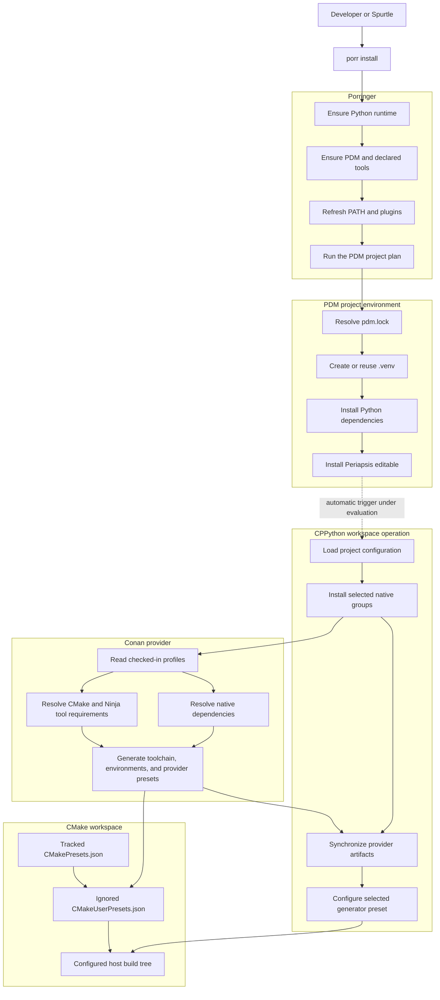
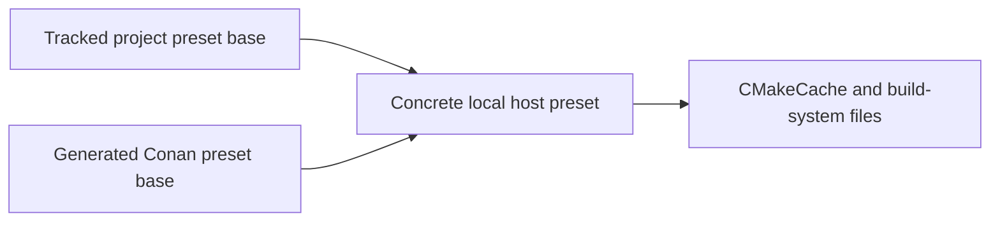

## Status

This draft supersedes the earlier proposal to install an editable CPPython CLI
with pipx and invoke `cppython bootstrap` from a PDM `post_install` script.

The end-state architecture and ownership boundaries are defined below. One
implementation decision remains open: whether automatic workspace preparation
is triggered by Periapsis's editable build or by a second explicit Porringer
project step. A focused spike must settle that choice before implementation.

## Outcome

After a successful `porr install`, Periapsis must have:

- a synchronized Python development environment;
- native dependencies and native build tools available through Conan;
- generated provider toolchain, environment, and preset files;
- one selected host CMake preset configured into a durable project build tree;
- no uncommitted generated files.

Installation stops after CMake configure. It does not build the library or test
targets, discover CTest tests, or execute tests. The user or IDE performs those
steps later.

No global CPPython installation is required. CMake and Ninja should not come
from a temporary PEP 517 build environment because their paths are recorded in
the durable CMake tree.

## Plain-language model

The workflow has four layers:

| Layer | Responsibility |
| --- | --- |
| Porringer | Reconcile machine-level prerequisites and invoke the project installer. |
| PDM | Create `.venv`, install Python dependencies, and install Periapsis as editable. |
| CPPython | Compose the selected native provider and generator into one workspace-preparation operation. |
| Conan and CMake | Materialize native dependencies, tools, environment, presets, and the configured build tree. |

In short: Porringer prepares the machine, PDM prepares Python, CPPython
coordinates native tools, Conan provides native state, and CMake owns the build
tree.

## Installation flow



Text equivalent:

1. Porringer ensures the Python runtime and PDM are available, refreshes PATH,
   and runs the PDM project command plan.
2. PDM creates or reuses `.venv`, installs Python dependencies, and performs
   the editable self-install.
3. The selected automatic trigger invokes one CPPython workspace operation.
4. CPPython asks Conan to install native dependency groups and build tools.
5. Conan generates the native toolchain, environment, and provider presets.
6. CPPython asks the CMake generator to configure a concrete host preset.
7. The process stops with a configured build tree.

## Ownership boundaries

### Porringer

Porringer owns:

- runtime, package, tool, SCM, and project phase ordering;
- project command planning and execution;
- preview, progress, cancellation, failure reporting, and logs;
- refreshing PATH and plugin discovery before project installation.

Porringer does not own CMake presets, Conan profiles, compilers, native
dependency groups, or test discovery. Its current `ProjectPhase.refresh()`
already refreshes PATH before `pdm install`; the architecture does not require a
new native phase.

### PDM and pdm-backend

PDM owns `.venv`, Python dependency synchronization, and editable project
installation. Periapsis remains packaged by `pdm.backend`.

PDM is not the native build orchestrator. If its editable build becomes the
automatic trigger, Periapsis uses a tiny project-local adapter that calls the
public CPPython workspace operation. The adapter must not turn CPPython into a
general replacement or wrapper for `pdm.backend`.

### CPPython end-state

CPPython owns one provider-neutral operation:

```text
Project.prepare_workspace(groups, configuration)
```

That operation composes existing provider installation and synchronization
with one narrow generator capability:

```text
configure(configuration)
```

CPPython does not own a second build lifecycle. Existing `build`, `test`,
`bench`, `run`, and `list targets` operations remain separate. Workspace
preparation does not build targets or inspect tests.

### Conan

Conan owns:

- native package resolution and caching;
- checked-in host and build profile interpretation;
- CMake and Ninja `tool_requires`;
- compiler and build environment generation;
- `conan_toolchain.cmake` and dependency configuration files;
- provider configure, build, and test presets;
- local IDE integration through generated preset files.

CPPython should consume Conan's `VirtualBuildEnv`, `conanvcvars` support, and
generated preset environments before adding a separate MSVC activation system.
Normal development uses explicit checked-in profiles; automatic default-profile
detection is only an opt-in bootstrap fallback.

### CMake and VS Code

CMake owns configure, build, and test semantics. VS Code CMake Tools owns preset
selection and the Test Explorer UI. CPPython may select a preset for configure,
but it does not replace CMake Tools or persist VS Code settings.

## Preset ownership and composition

CMake's standard two-file ownership model is the target design:

| File | Ownership | Version control |
| --- | --- | --- |
| `CMakePresets.json` | Periapsis project and platform policy | Tracked |
| Provider preset file | Conan toolchain and environment policy | Generated, ignored |
| `CMakeUserPresets.json` | Machine-local composition of project and provider presets | Generated, ignored |

`CMakeUserPresets.json` implicitly sees the tracked `CMakePresets.json` and may
include the provider-generated preset file. Concrete local presets can then
inherit one project base and one provider base. This lets CMake Tools and the
CLI use the same preset graph without CPPython mutating tracked preset files.

The target composition is:



Text equivalent: each concrete host preset combines Periapsis policy, such as
the generator and build directory, with Conan policy, such as the toolchain,
native tools, and build environment.

If standard root preset discovery is sufficient, the architecture does not
need a separate CPPython `preset_file` versus `presets_file` command model or
mandatory CMake 4.4 `--presets-file` usage.

## Persistent state after installation

### Machine and user state

The machine retains:

- a Python 3.14 runtime;
- PDM and Porringer as user-facing tools;
- a host compiler and SDK, such as the Visual Studio C++ workload, GCC, or
  Clang;
- the user's Conan home and package cache.

The workflow does not persist an activated developer-shell environment or a
captured MSVC environment in project configuration.

### Periapsis `.venv`

The project virtual environment contains:

- CPPython;
- the Conan Python client;
- `pdm-backend`;
- CPPython's required Python extras;
- Periapsis's Python lint, test, documentation, and configuration tools;
- editable Periapsis metadata and source-path integration.

It does not need to contain CMake, Ninja, GTest, Benchmark, or compiler
binaries. Those are native provider or system concerns.

### Conan home

The Conan home contains persistent package binaries and metadata for:

- CMake and Ninja tool requirements;
- GTest and Benchmark;
- transitive native dependencies;
- any native packages built locally because no compatible binary was
  available.

Checked-in project profiles are passed explicitly. Normal development must not
depend on mutating or auto-detecting a shared default Conan profile.

### Periapsis checkout

Tracked project state includes:

```text
pyproject.toml
pdm.lock
pdm_build.py                 # only if the editable-build trigger wins
conanfile.py
tool/conan/profiles/...
CMakePresets.json
tool/cmake/platform/...
```

Ignored machine-local state includes:

```text
.venv/
.pdm-python
.cppython.toml
CMakeUserPresets.json
build/
```

The configured native tree is expected to resemble:

```text
build/
|-- generators/
|   |-- conan_toolchain.cmake
|   |-- conan_cmakedeps_paths.cmake
|   |-- provider preset files
|   |-- conanbuild.*
|   `-- dependency configuration files
`-- <host-preset>/
    |-- CMakeCache.txt
    |-- CMakeFiles/
    `-- build.ninja
```

A successful installation leaves `git status` clean.

## Build isolation guardrail

Scikit-build-core and meson-python both document the same failure mode: a
durable IDE tree becomes invalid when it records executables, include paths, or
packages from a temporary build-isolation environment.

If the editable-build trigger is selected, Periapsis must disable PDM build
isolation for install and sync. CPPython and `pdm-backend` must already be
installed in `.venv` before PDM performs the editable self-build. The clean
installation test must prove this ordering.

No path recorded in `CMakeCache.txt`, generated presets, or compile commands may
refer to a temporary `pdm-build-*`, `pip-build-env-*`, or equivalent build
environment.

## Open decision: automatic trigger

Both options produce the same final filesystem state. The difference is how
workspace preparation is attached to installation.

### Option A: project-local editable-build adapter

Periapsis contains a small `pdm_build.py` with only a
`pdm_build_finalize(context, artifact)` hook. It calls CPPython only when:

- `context.target == "editable"`;
- the backend config setting `cppython.workspace=true` is present;
- the editable artifact was built successfully.

Periapsis injects the config setting and `--no-isolation` only into its normal
PDM install and sync commands. Metadata, wheel, sdist, docs-only, dry-run, and
unrequested editable operations must not prepare the native workspace.

Advantages:

- plain `pdm install` and `porr install` produce the same workspace;
- the extension uses PDM Backend's documented hook API;
- no PDM `post_install` lifecycle script is required.

Risks:

- native work is nested inside the PDM project action;
- clean dependency ordering and dry-run purity must be proven;
- cancellation and logs are less structurally visible to Porringer.

### Option B: explicit workspace project step

The PDM project plan executes two commands:

1. `pdm install`;
2. `pdm run workspace`, where the project script calls
   `cppython workspace`.

Advantages:

- preview and execution show the native operation as a separate step;
- failure, retry, timing, and cancellation are easier to report;
- packaging and native workspace preparation remain completely separate.

Risks:

- Porringer's PDM plugin gains a small project-script convention;
- plain `pdm install` alone does not prepare the workspace;
- the project must expose a stable workspace script name.

Option A is preferred only if the trigger spike passes every acceptance test.
Option B is the fallback. A generic PDM `post_install` hook is not the fallback
because it has the same hidden-work and dry-run concerns without target-aware
PEP 660 semantics.

## End-state by repository

### CPPython

CPPython ends with:

- one public `prepare_workspace` operation;
- one narrow optional generator `configure` capability;
- provider synchronization data that can describe generated toolchains,
  environments, and preset artifacts;
- no universal delegated backend configuration;
- no `BootstrapGenerator` or host lifecycle maps;
- no requirement for pipx or a sibling editable installation.

Conan profile detection moves out of provider construction. Explicit profiles
are the normal path; detection, if retained, is an opt-in bootstrap fallback.

### Porringer end-state

Porringer keeps its current phase model and plain project-installer boundary.
It may need tests for same-run PATH refresh and nested cancellation, but no
CMake- or CPPython-specific core API.

### Periapsis

Periapsis remains on `pdm.backend`, adopts checked-in Conan profiles and
provider tool requirements, generates local user presets, and requests one
configure-only workspace operation during normal development installation.

`gtest_discover_tests(tests)` remains unchanged. Tests appear in Test Explorer
after the user or IDE builds the `tests` target and refreshes CMake tests.

### Shared workflows

Generic Python workflows use `pdm install --no-self` when native configuration
is unnecessary. A separate native-workspace acceptance workflow verifies clean
configure, repeat installation, and deleted-tree rematerialization without
making every Python project native-aware.

## Reset and recovery

| Goal | Remove | Recovery command |
| --- | --- | --- |
| Reconfigure the native workspace | `build/` and `CMakeUserPresets.json` | Run the selected install workflow again. |
| Recreate Python tooling | `.venv/` and `.pdm-python` | Run `porr install` again. |
| Recreate native dependencies and tools | Relevant Conan cache entries | Run the selected install workflow again. |
| Refresh tests only | Test build outputs | Build `tests`, then refresh CMake Tests. |

Clearing the Conan cache may invalidate absolute native-tool paths in an
existing CMake cache. Reinstallation must regenerate provider state and
reconfigure the build tree.

## Trigger spike

Before implementing the complete workflow, build the smallest possible marker
spike for Option A. It must demonstrate that:

1. `porr preview` and `pdm install --dry-run` write no files.
2. Editable metadata preparation writes no workspace files.
3. Wheel and sdist builds write no workspace files.
4. A clean `pdm install` invokes the adapter only after Python dependencies are
   available.
5. A second install is idempotent.
6. Deleting the marker and rerunning install recreates it.
7. `pdm install --no-self` skips workspace preparation.
8. Cancellation stops the nested operation.
9. No durable file records a path into build isolation.

If any requirement relies on undocumented PDM behavior or cannot be tested
reliably, select Option B.

## Rollout

1. Complete the trigger spike and record the Option A or Option B decision in
   this document.
2. Simplify provider and preset ownership around checked-in Conan profiles and
   generated user presets.
3. Add CPPython's `prepare_workspace` and generator `configure` capability.
4. Adopt the selected trigger in Periapsis.
5. Raise the CMake baseline to 4.4 and update the experimental `import std`
   UUID to `451f2fe2-a8a2-47c3-bc32-94786d8fc91b` in the provider-owned
   toolchain path.
6. Validate clean configure and idempotency on supported Windows, Linux, and
   macOS toolchains.
7. Add the shared native-workspace CI workflow.

## Out of scope

- Building native targets during installation.
- Discovering or running tests during installation.
- Automatically selecting a VS Code preset in a new workspace.
- Replacing CMake Tools or CTest Test Explorer.
- Persisting a captured compiler environment.
- Adding CMake or Conan semantics to Porringer core.
- Migrating unrelated Porringer or CPPython consumers.
